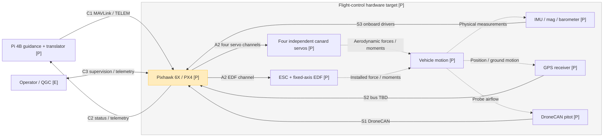
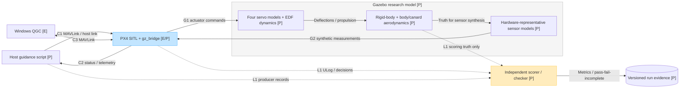
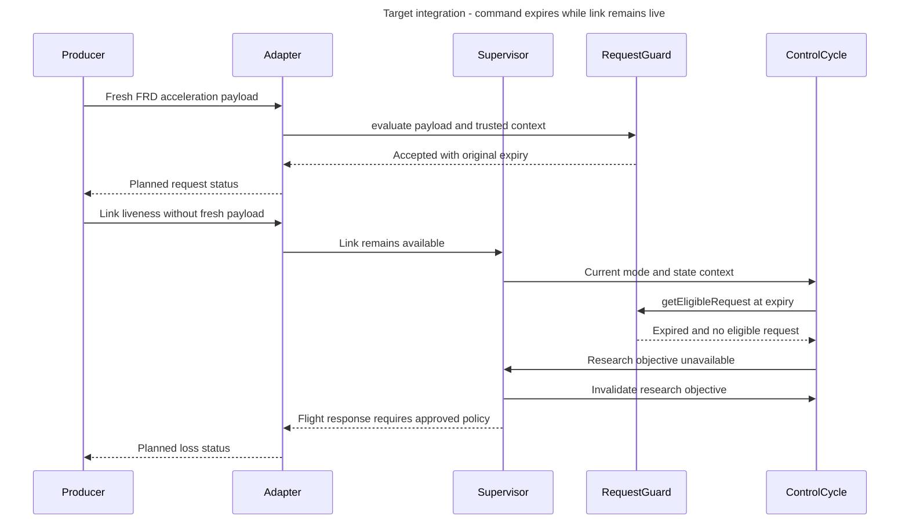

# Research vehicle architecture and interfaces

Revision: 2026-09-17. Updated after the S1 standalone software gate.

These diagrams describe the intended research system and explicitly distinguish implemented foundations from future integration. They do not approve physical feasibility, a flight law, actuator output, hardware operation or a MAVLink wire schema.

The older `SITL_ARCHITECTURE.md` is preserved unchanged as a baseline reference; this document is the current research-vehicle view.

## Reading the diagrams

- `[V]`: implemented and host-tested standalone software. RequestGuard and FrameMath are not connected to an active PX4 mode.
- `[E]`: existing PX4/Gazebo/QGC infrastructure, not proof of research-vehicle compatibility or hardware qualification.
- `[P]`: planned implementation, physical configuration or integration; not demonstrated.
- `[E/P]`: an existing mechanism with research-specific work still pending.
- Solid arrows carry data or commands. Dotted arrows denote physical effects, supervision or independent evaluation, as their labels specify; arrow style does not indicate implementation status.
- C/S/A/G/E/L identifiers refer to the interface catalog below. The same identifier may appear in alternative deployment views.

All-three-axis inertial acceleration in FRD is the only companion control objective. Position, velocity, attitude, rate, thrust and servo demands are not companion control inputs. Mode/liveness/session metadata is separate from those objectives. NED is the estimator world convention.

## 1. Intended physical deployment

Pi guidance and its translator form one logical request producer. PX4 owns estimation, stabilization, allocation, supervision and actuator outputs. QGC is an operator/observation interface, never a second research-acceleration publisher. The physical QGC link, servo/ESC protocols, pin assignments and GPS bus are deliberately left unspecified.

The physical-effect arrows do not assert that canards have adequate airflow at release, that EDF wash reaches them, or that thrust aligns through the CG. A scalar pitot measurement is not a full air-relative velocity vector. Sensor placement/calibration and installed actuator behavior remain unqualified. No servo-position or EDF-speed feedback sensor is assumed by this view.

## 2. Intended SITL deployment and truth boundary

This replaces the physical vehicle with a separately versioned plant and hardware-representative sensor models. The host script replaces the Pi producer for initial experiments; a later Pi-in-the-loop test substitutes the physical Pi as the sole producer. This is not Pixhawk-in-the-loop.

`gz_bridge` is inside the PX4 SITL process, not a standalone MAVLink simulator. Gazebo actuator/sensor communication uses Gazebo Transport; the guidance and QGC paths use MAVLink. Simulator-native frames must be converted explicitly to PX4 NED/FRD at the documented model/bridge boundary.

Truth is allowed to drive simulated sensors and independent scoring. There is no direct truth-to-operational-controller input and no scorer-to-controller feedback. The simulated pitot must represent its hardware counterpart and local airflow rather than silently substituting ground speed.

Custom model resources are planned under `models/research_vehicle/`, outside the separate `Tools/simulation/gz` repository. No custom asset has been created yet. Stock `gz_rc_cessna` remains an independent regression baseline. The existing WSL launcher has shared paths; concurrent simulator builds require separately reviewed mount/cache/port isolation.

## 3. Acceleration-to-actuator path and PX4 ownership

This is a functional pipeline, not a promise of one new software module per box. The two green blocks are the only new implemented research components, and they are inactive standalone libraries. All drawn links into those libraries are planned integration.

```mermaid
flowchart LR
    producer["One research producer [P]"]
    actuators["Canards + EDF [P]"]
    subgraph flightStack ["PX4 research command path - target integration"]
        ingress["MAVLink adapter [P]"]
        guard["RequestGuard [V library]"]
        frames["FrameMath [V library]"]
        resolver["Feasible objective resolver [P]"]
        stabilize["Attitude / rate control [P]"]
        normalize["Wrench normalization + publisher [P]"]
        allocator["Allocator [E] + research effectiveness [P]"]
        output["Output driver / gz_bridge [E/P]"]
        estimates["Estimator + validated sensors [E/P]"]
        supervisor["Commander + research supervision [E/P]"]
    end
    producer -->|"C1 acceleration + metadata"| ingress
    ingress -->|"Decoded canonical request"| guard
    guard -->|"Fresh eligible FRD request"| frames
    frames -->|"Acceleration / specific force"| resolver
    resolver -->|"Jointly feasible objectives"| stabilize
    stabilize -->|"Force / moment demand"| normalize
    normalize -->|"A1 thrust then torque"| allocator
    allocator -->|"Normalized actuator demands"| output
    output -->|"A2 or G1"| actuators
    estimates -->|"E1 current attitude"| frames
    estimates -->|"E1 state / validity"| resolver
    estimates -->|"E1 attitude / rates"| stabilize
    estimates -->|"State health"| supervisor
    supervisor -.->|"E2 trusted context"| guard
    supervisor -.->|"Mode ownership / resets"| stabilize
    allocator -.->|"Residuals / saturation"| stabilize
    guard -.->|"Rejection / loss status"| supervisor
    style flightStack fill:#F5F5F5,stroke:#B3B3B3
    style guard fill:#CDF4D3,stroke:#66D575
    style frames fill:#CDF4D3,stroke:#66D575
    style resolver fill:#FFECBD,stroke:#FFC943
    style normalize fill:#FFECBD,stroke:#FFC943
```

Command stages have exactly one active owner: producer; ingress adapter; research objective resolver; attitude/rate demand; normalized wrench publisher; allocator; output driver. Stock controllers cannot concurrently publish into the research-owned stages. Commander remains the supervision owner, not a competing actuator-command producer.

`FrameMath` applies the working CG reference and current-body-held semantics: `a_req_N = R_NB(current attitude) * a_req_B`, and `f_req_B = a_req_B - R_NB^T * g_N`. Thus zero inertial acceleration is not zero specific force. Gravity, bounds and timing must be explicit approved inputs; fixture numbers are not operational defaults.

The resolver must account jointly for available force and stabilizing moment, with PX4 resolving remaining attitude/roll objectives internally. A generic three-axis request does not imply arbitrary instantaneous force authority. The control-law, effectiveness scheduling and physical-to-normalized mapping remain unselected; this diagram does not prescribe a PID cascade or invent gains.

Publish coordinated `vehicle_thrust_setpoint` and `vehicle_torque_setpoint` values in normalized body coordinates, not N or N m. In this checkout torque publication triggers allocation and thrust is cached, so the proposed publisher writes thrust before torque. Coupled saturation/residual feedback must support limiting and anti-windup; its integration remains to be tested.

## 4. Command loss is not the same as link loss

Illustrative target sequence: a trusted session was established while disarmed; research mode is selected, required estimates are valid, and a request was accepted while armed. This is one scenario, not an implemented MAVLink exchange or a complete supervisor state machine. RequestGuard methods exist and are tested; all callers/status transport below are planned.

The sequence stops at the unresolved flight-response boundary. Revoking an acceleration objective does not mean automatically cutting the EDF, holding surfaces, hovering, landing or entering RTL. Those actions require a vehicle-feasible, human-approved policy and integration tests.

S1 enforces original expiry, age/order checks, no cached-request resurrection and fixed clock-fault latches. A malformed/foreign packet does not replace or refresh a still-valid owner request; independently observed context loss still revokes it. A reconnect cannot clear a latch. A trusted authorized disarmed reset and different session are required for clock-latch recovery. Identity/session labels are not authentication.

## Interface catalog

These are logical interfaces, not newly assigned message IDs, topic definitions or hardware pins.

| ID | Interface and ownership | Data / frame / units | Status and unresolved details |
| --- | --- | --- | --- |
| C1 | One host-script or Pi-translator producer to PX4 MAVLink adapter | Three finite inertial acceleration components, FRD, m/s^2; working CG reference; protocol, owner/session, sequence, original creation/expiry and validity metadata | MAVLink selected; exact message/dialect, host transport endpoint, serial baud/port, serialization and clock-sync mechanism not selected. No direct body-vector write into NED trajectory fields. |
| C2 | PX4 adapter/supervisor back to producer | Correlated request acceptance/rejection, age/expiry, active/limited/saturated state and loss reason; estimator/mode telemetry | Planned status schema and serialization; transport receipt must not be labelled tracking success. |
| C3 | Operator/QGC to PX4 supervision, with return telemetry | Mode/arming requests, status and observation; not research acceleration control | Existing MAVLink mechanisms; research permissions/acknowledgements and hardware link need review. Host ports must follow run configuration, not assumptions. |
| S1 | Pitot via DroneCAN driver into PX4 sensor/air-data processing | Differential pressure or calibrated scalar airspeed as the actual sensor provides; Pa / m/s with validity and timing | Hardware category selected; exact sensor messages, installation, calibration, rates and latency remain unknown. Not full 3D air-relative velocity. |
| S2 | GPS receiver via selected driver into PX4 estimation | Position, ground-relative motion, time/quality according to receiver protocol | Sensor category selected; receiver, bus, rate, latency and estimator configuration TBD. Ground velocity is not air velocity. |
| S3 | Pixhawk onboard sensors via drivers into estimation | IMU, magnetometer and barometer measurements with frames/calibration/timestamps | Existing sensor infrastructure; exact board configuration, installation, rates and validity need qualification. IMU specific force is not inertial CG acceleration. |
| E1 | PX4 estimator/validated sensor processing to research control | Current attitude q_NB, body rates, NED state and approved scalar air data, with timestamps/health | Existing estimates; exact research subscriptions, age limits, lever-arm treatment and air-state observability are integration decisions. No truth subscriptions. |
| E2 | Trusted PX4 supervisor/adapter to RequestGuard and control owner | Current monotonic time, armed/mode state, clock-mapping validity, link/state validity; explicit session/reset authorization | Canonical guard API tested; PX4 wrapper not implemented. Caller must observe all transitions, serialize access and bound clock uncertainty across the whole request lifetime. |
| A1 | Sole normalized-wrench publisher to PX4 Control Allocator | Normalized body thrust and torque topics; coordinated thrust-before-torque publication | Existing topics/allocator, future research publisher and effectiveness. Physical N / N m must be explicitly scaled; unavailable directions, residuals and saturation require tests. |
| A2 | PX4 allocator through output driver to physical actuators | Four independent canard channels and one EDF/ESC channel, mapped from normalized actuator demands | Selected logical topology, unselected electrical protocols/pins, signs, neutral/ranges, slew limits and failure behavior. No feedback channel assumed. |
| G1 | PX4 gz output interfaces to Gazebo actuator plugins | Existing servo angle output in radians and motor-speed command topic; research mapping must be defined | Stock mechanisms exist; EDF/surface plant interpretation and units/scaling/signs need validation. These are not physical thrust commands. |
| G2 | Gazebo synthetic sensors through gz_bridge to PX4 sensor paths | Hardware-representative measurements with explicit simulator/PX4 frame, time and unit conversion | Stock mechanisms exist; research sensor models, noise, bias, rate, lag and faults unimplemented/unqualified. Hardware DroneCAN transport is not implied by a simulated air-data measurement. |
| L1 | Producer, PX4 and simulation to independent evidence tools | Original commands, decisions, ULog/estimates, normalized outputs, truth for scoring, configuration/source hashes | Evidence specification exists; automated checker/scorer/run-manifest implementation remains pending. No control feedback from evaluation. |

## Release boundaries and open decisions

Implemented now: inactive RequestGuard and FrameMath with recorded host-test evidence. Not implemented: host guidance application, Pi translator, research wire adapter, active modified Offboard controller, custom plant, research allocation and physical output integration.

Before turning the diagrams into an active system, approve the wire/status contract and supervision mapping; supply versioned geometry/mass/CG/inertia, local-flow/aerodynamic and installed actuator evidence; establish a jointly feasible envelope; select residual-attitude and command-loss policies; then review control/normalization/allocation and end-to-end tests. Nose-up release from rest and headfirst net capture remain intended scenarios, not demonstrated capabilities. The 2.5 kg / 5.5 kgf expectations are not model/controller constants.

No new architecture or phase approval is implied by these diagrams. Same reviewed flight-control source is the portability goal; Linux SITL and Pixhawk use different binaries. Firmware compilation, resource/timing verification and human-led physical validation remain later gates.

## Traceability

- [Current gate status](PHASE_GATE_STATUS.md)
- [Requirements and physical unknowns](RESEARCH_VEHICLE_REQUIREMENTS.md)
- [Acceleration interface and pinned PX4 source trace](ACCELERATION_INTERFACE.md)
- [Preliminary control architecture](CONTROL_ARCHITECTURE.md)
- [S1 source hashes and verification](RESEARCH_ACCELERATION_S1_VERIFICATION.md)
- [Evidence/test specification](SITL_TEST_SPECIFICATION.md)

## Editable rendered views

The Mermaid above is the durable repository source. These generated previews can be opened for editing in FigJam; the service supplied separate claim links, not a reusable board file key. Claim/save the views if you need persistent external copies. Generated previews report expiry on 2026-09-24.

- [Hardware interfaces](https://www.figma.com/online-whiteboard/create-diagram/03475503-a50b-4ad7-8bf5-c190ae9c2e5b?utm_source=chatgpt&utm_content=edit_in_figjam&oai_id=v1%2FpQ06CKBrbJxMgSQVTpwyaKuY6SznbZxl9HOAr5yvDgPtEapjQF46u5&request_id=e5487e24-6706-4aca-9eae-20cca6c8a8ab)
- [SITL and ground-truth boundary](https://www.figma.com/online-whiteboard/create-diagram/81f6ffc3-28f5-4301-ac51-a545ac81299b?utm_source=chatgpt&utm_content=edit_in_figjam&oai_id=v1%2FpQ06CKBrbJxMgSQVTpwyaKuY6SznbZxl9HOAr5yvDgPtEapjQF46u5&request_id=bc1f4617-b0d7-407d-b4d0-e1e8eed8506a)
- [Acceleration-to-actuator ownership](https://www.figma.com/online-whiteboard/create-diagram/d589b604-8d15-4085-8e5f-23bc3d11c55f?utm_source=chatgpt&utm_content=edit_in_figjam&oai_id=v1%2FpQ06CKBrbJxMgSQVTpwyaKuY6SznbZxl9HOAr5yvDgPtEapjQF46u5&request_id=16ad8a38-40c9-49ee-ac3c-eecaf82bb324)
- [Command expiry with a live link](https://www.figma.com/online-whiteboard/create-diagram/c137600f-3c6e-43f6-ac38-92b2cbcd33fb?utm_source=chatgpt&utm_content=edit_in_figjam&oai_id=v1%2FpQ06CKBrbJxMgSQVTpwyaKuY6SznbZxl9HOAr5yvDgPtEapjQF46u5&request_id=db8a54e9-3740-4f0e-ae62-7d36660cc956)
