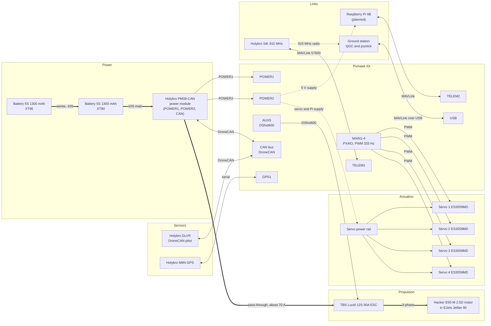

# SLAAPS wiring diagram

Status: draft, 2026-11-22. Built from the connections table in `docs/SLAAPS_BOM.md`. Dashed lines or "?" mark connections that are not
yet documented. The diagram renders in GitHub and in any Mermaid viewer.

## Notes
- **Single point of failure.** One PM08-CAN carries the whole EDF current, the flight controller, the servo rail and the Pi. A fault or sag on it
  takes all of them out together.
- **POWER2 split.** Which POWER2 pins or leads reach the servo rail and the Pi is not recorded, so those two lines are dashed.
- **Not documented:** the M9N variant (it is on GPS1, a serial port), the CAN port (CAN1 or CAN2) and bus termination, the Pi's baud rate, and how the rail is distributed
  to the four servos.
- **Servo order:** servos 1 to 4 are on MAIN1 to MAIN4. The plugs for servos 3 and 4 were swapped and fixed on 2026-11-05.
- **MAIN versus AUX:** the servos are on the PX4IO rail (bank 0) and the EDF is on the FMU rail (bank 1). On 2026-11-22 the MAIN bank was the slow
  one to acknowledge activation (about 43 ms against 7 ms for AUX).
